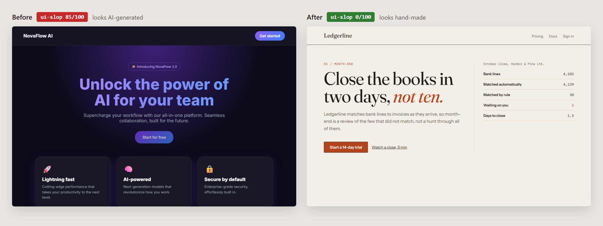

<h1 align="center">ui-slop</h1>

<p align="center">
  <b>Does your UI look AI-generated?</b><br>
  Score it from 0 (hand-made) to 100 (pure slop), see every line that pulled it up, and how to fix each one.
</p>

<p align="center">
  <a href="https://github.com/Ahmed8881/ui-slop/actions/workflows/ci.yml"></a>
  
  
  <a href="LICENSE"></a>
</p>

<p align="center">
  
</p>

## Try it

```bash
npx ui-slop https://your-site.com
npx ui-slop src/
```

No install, no config, no dependencies. It reads HTML, CSS, JS/TS, JSX/TSX, Vue, Svelte,
Astro and MDX, and live URLs with their stylesheets. It does not matter who wrote the UI:
you, Cursor, Copilot, v0, Lovable, Bolt, or Claude.

<p align="center">
  
</p>

Both pages above are in [`docs/demo/`](docs/demo). The scores and the terminal output
are real, regenerated by [`docs/make-images.mjs`](docs/make-images.mjs).

## What it looks for

**Slop** is the set of defaults that makes generated UI recognizable at a glance. Each
rule adds its points once it fires; the points sum to 100.

| Rule | Points | Catches |
|---|---:|---|
| `generic-font` | 20 | Inter, Roboto, Poppins, Montserrat, Space Grotesk, DM Sans or Arial as the main face |
| `purple-gradient` | 20 | The purple-to-blue gradient, in CSS or Tailwind |
| `emoji-icon` | 15 | Emoji standing in for icons (2 or more) |
| `cliche-copy` | 15 | "Unlock the power", "seamless", "supercharge"... (3 or more different ones) |
| `gradient-text` | 10 | Gradient-filled headline text |
| `tailwind-default` | 10 | The stock Tailwind palette instead of your own tokens (5 or more) |
| `glassmorphism` | 5 | Backdrop-blur cards (2 or more) |
| `rounded-everything` | 5 | `rounded-2xl` or a 20px+ radius on everything (6 or more) |

**Issues** are real defects that tend to ship with generated UI. They are listed with a
fix but do not change the score:

| Rule | Catches |
|---|---|
| `focus-removed` | `outline: none` with no visible focus style in its place |
| `transition-all` | `transition: all` |
| `img-alt` / `img-size` | Images without `alt`, or without dimensions (layout shift) |
| `div-click` | Clickable `<div>` or `<span>` instead of a `<button>` |
| `blank-rel` | `target="_blank"` without `rel="noopener noreferrer"` |
| `html-sink` | `innerHTML`, `dangerouslySetInnerHTML`, `v-html`, `{@html}` |
| `client-secret` | Secrets in `NEXT_PUBLIC_` / `VITE_` variables, live Stripe keys |
| `reduced-motion` | Animation with no `prefers-reduced-motion` handling anywhere |

| Score | Verdict |
|---|---|
| 0-19 | looks hand-made |
| 20-49 | some generic defaults |
| 50-100 | looks AI-generated |

For calibration, on release day: GitHub scored 0, Linear and Stripe 15.

## Use it in CI

```yaml
# .github/workflows/ui-slop.yml
name: ui-slop
on: pull_request
permissions:
  contents: read
jobs:
  ui-slop:
    runs-on: ubuntu-latest
    steps:
      - uses: actions/checkout@v4
      - uses: Ahmed8881/ui-slop@v0.1.0
        with:
          path: src          # files, folders or URLs, space-separated
          max-score: 30      # fail when the UI drifts generic
          max-issues: 0      # and on any accessibility or safety issue
```

The full report lands in the job summary, and the score is available as
`steps.<id>.outputs.score`.

From the command line:

```bash
npx ui-slop src --max-score 30 --max-issues 0   # exit 1 when over a limit
npx ui-slop src --json                           # machine-readable
npx ui-slop src --markdown                       # for PR comments
```

Exit codes: `0` ok, `1` over a limit, `2` usage or scan error.

## Show your score

```bash
npx ui-slop src --badge ui-slop.svg
```

Commit `ui-slop.svg` and add `` to your README. It is green
under 20, amber under 50, red above.

## Limits

- **It reads code; it does not render.** A URL scan reads the HTML the server sends plus
  its stylesheets. Single-page apps that render everything in the browser show little;
  scan their source folder instead.
- **A hit is a prompt to look, not a verdict.** A brand that really is purple will trip
  `purple-gradient`. That is fine: you know why.
- **A low score means you avoided the clichés**, not that the design is good.

## Fix what it finds

ui-slop tells you what looks generated. To have your coding agent build UI that doesn't,
use [ahmed-ui-craft](https://github.com/Ahmed8881/ahmed-ui-craft), a Claude Code skill
built on the same rules.

## Contributing

New rules are welcome when they come with evidence: a case they catch, a close case they
don't, and a check on real, well-made sites. See [CONTRIBUTING.md](CONTRIBUTING.md).
Security reports go through [SECURITY.md](SECURITY.md).

## License

[MIT](LICENSE) © Ahmed Butt
